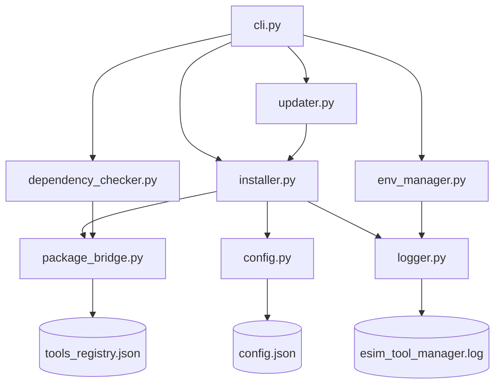

# eSim Automated Tool Manager Architecture

### Section 1 — Introduction
eSim is an open-source EDA tool for circuit design, simulation, analysis, and PCB design. It integrates several external tools and libraries to provide a seamless environment for engineers and researchers. Managing these tools manually can be tedious, especially when considering updates, compatibility, and user-specific configurations. The "Automated Tool Manager" for eSim (preferably in python) that automates the installation, configuration, update, and management of external tools and dependencies.

### Section 2 — System Architecture
Include a Mermaid diagram showing all module relationships:

### Section 3 — Module Descriptions
- **cli.py**: Typer-based CLI interface. Handles user commands and maps them to core logic modules.
- **installer.py**: Core installation engine. Handles version pinning, download/extraction, and verification.
- **updater.py**: Update checker and upgrade logic. Compares installed versions against the registry.
- **dependency_checker.py**: Dependency validation engine. Checks for missing and incompatible (version-specific) dependencies.
- **env_manager.py**: PATH and environment variable handler. Automates the configuration of installed tools.
- **package_bridge.py**: apt / Homebrew / Chocolatey integration. Provides a unified interface for system package managers.
- **config.py**: User-level configuration loader/writer. Manages tool installation history and user preferences.
- **logger.py**: Centralized logging module. Records all actions for auditing and troubleshooting.

### Section 4 — Component Interaction Walkthrough
Example: `esim-tool install ngspice`
1. User runs command → `cli.py` receives `tool_name="ngspice"`
2. `cli.py` calls `dependency_checker.check_dependencies("ngspice")`
3. If any dep is missing or incompatible → `display.print_dependency_table()` + abort with fix instructions
4. `cli.py` calls `installer.install_tool("ngspice")`
5. `installer.py` loads `data/tools_registry.json`
6. `installer.py` calls `package_bridge.detect_package_manager()` → returns `"apt"` (on Linux)
7. `installer.py` calls `package_bridge.run_package_manager_install("apt", "ngspice")`
8. On success: calls `env_manager.apply_tool_env("ngspice")`
9. Calls `config.set("installed_tools.ngspice", {...})`
10. `logger.py` logs every step at DEBUG level throughout
11. `cli.py` calls `display.print_success("ngspice installed successfully")`

### Section 5 — Platform Support Matrix
| OS | Tool | Package Manager | Fallback URL Available |
|---|---|---|---|
| Linux | Ngspice | apt | Yes |
| Linux | KiCad | apt | No |
| Linux | OpenModelica | apt | No |
| Windows | Ngspice | Chocolatey | Yes |
| Windows | KiCad | Chocolatey | Yes |
| Windows | OpenModelica | Chocolatey | Yes |
| macOS | Ngspice | Homebrew | No |
| macOS | KiCad | Homebrew | No |
| macOS | OpenModelica | Homebrew | Yes |

### Section 6 — Configuration Schema
The user configuration is stored in `~/.esim_tool_manager/config.json`:
- `esim_home`: (string) Path to eSim home directory.
- `auto_update_check`: (boolean) Enable/disable automatic update checks on startup.
- `preferred_install_method`: (string) Default install method (package_manager or url).
- `installed_tools`: (dict) A registry of tools currently managed by the tool manager, including version and platform metadata.

### Section 7 — Error Handling Strategy
- **Subprocess failures**: Non-zero exit codes from package managers or verify commands are logged at ERROR level, and the UI displays a descriptive error message with stderr details.
- **Network errors**: `requests.ConnectionError` is caught during tool downloads, and the user is prompted to check their connection or try a manual install.
- **Dependency issues**: Installations are aborted if critical dependencies are missing or incompatible, unless the `--force` flag is used.
- **Configuration errors**: If `config.json` is corrupted, a default configuration is automatically recreated, and the user is notified.

### Section 8 — Future Enhancements
- **GUI Interface**: A graphical frontend using Tkinter or PyQt6 for users who prefer not to use the command line.
- **Docker Isolation**: Support for running tools in isolated Docker containers to avoid dependency conflicts on the host system.
- **Plugin System**: Allow users to contribute custom tool definitions via community plugins.
- **Telemetry**: Optional usage tracking to improve tool manager features and registry updates.

---
*Built for eSim Summer Fellowship 2026 — Task 5*
